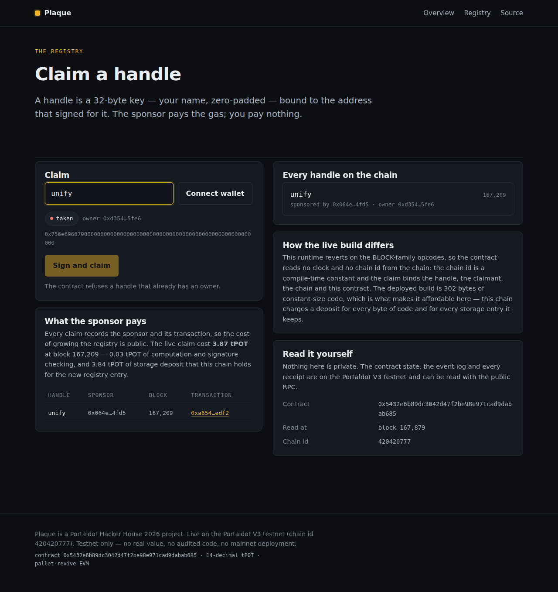
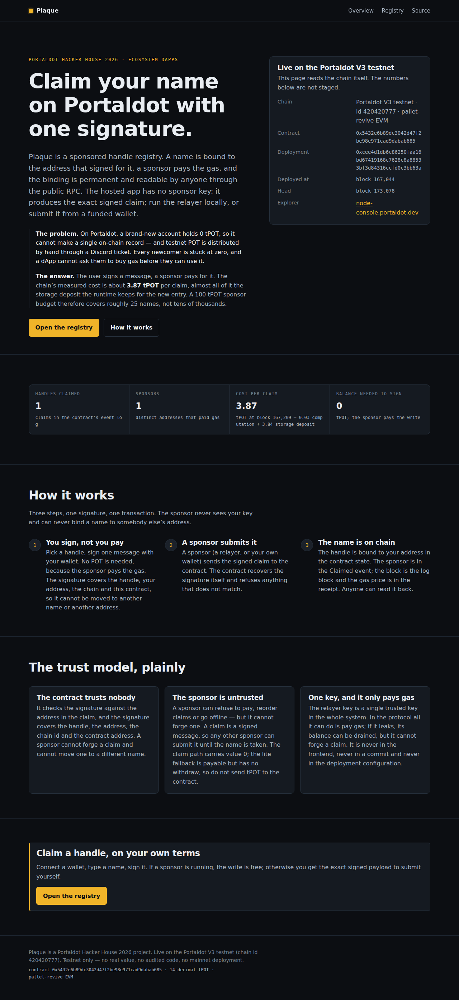

# Plaque

**A sponsored handle registry for the Portaldot V3 testnet. You sign; a sponsor pays; your name is on
chain.**

Built for the **Portaldot Hacker House 2026** — Track 4, *Ecosystem DApps*.

| | |
|---|---|
| Chain | Portaldot V3 testnet, chain id **420420777** (`pallet-revive` EVM) |
| Contract | **`0x5432e6b89dc3042d47f2be98e971cad9dabab685`** (`contracts/PlaqueLite.sol`) |
| Deployment tx | **`0xcee4d1db6c86250faa16bd67419168c7628c8a88533bf3d84316ccfd0c3bb63a`** (block **167044**) |
| Deployed bytecode | **302 bytes**, byte-for-byte identical to a fresh compile of the committed source |
| Live sponsored claim | **`0xa654bd9ce55b389c072b00d0c4af55ab067d76acc422d5636b0c62863786edf2`** (block **167209**) — signed by an account holding **0 tPOT** |
| Verifier | `npm run verify:live` — 10 checks against the public RPC, read-only, all passing |
| Explorer | <https://node-console.portaldot.dev> |
| Frontend | `web/` (Next.js 15, App Router) — live at **https://plaque-oxunify.vercel.app** |
| Repository | **https://github.com/unifyWeb3/plaque** |
| Tests | `npm test` — **33 tests, 33 pass, exit 0** |

---

## 1. The problem, and who has it

Portaldot is a new chain with a new token. A brand-new account holds **0 tPOT**, so it cannot make a
single on-chain record — and testnet POT is handed out by hand through a Discord support ticket.
Every person who arrives at the Portaldot ecosystem is therefore stuck at zero: they cannot claim a
name, register for a program, or leave any trace of themselves on the chain, and no dApp can ask them
to buy gas before they use it.

The audience is exactly that group: people joining the Portaldot ecosystem (the ~168 hackers
registered for this hackathon, ecosystem newcomers, and builders shipping their first dApp) — plus the
operators who want a permissionless directory instead of a hand-maintained list.

## 2. The solution

**Plaque** is a handle registry where the *user* never needs gas:

1. The user picks a handle and signs **one message** with their wallet.
2. A **sponsor** (a relayer, or the user's own wallet) submits the signed claim and pays.
3. The contract recovers the signature itself, binds the handle to the address that signed, and emits
   `Claimed(handle, who, sponsor)`. Anyone can read it back from the public RPC.

This is not a mock: the live claim in the header was signed by
`0xd35404A86f825741BA8a65a31Eb8ca1D52315Fe6`, an account whose balance was **0 wei before, during and
after** the claim, and was submitted and paid for by the sponsor
`0x064e2C32bb460Ea16A3C44A47fD9BE95CAbD4fD5`.

A *handle* is a 32-byte key: the UTF-8 name, zero-padded. The claim digest binds the handle, the
claimant address, the chain id and this contract, so a signed claim cannot be moved to another name,
another address, another chain or another contract.

### What a claim actually costs here (measured, not estimated)

| Part | Cost | How it was measured |
|---|---|---|
| Signature verification + computation | **≈0.028 tPOT** | the same call, aborted at the storage write, burned 850,785,408,901 gas |
| Storage deposit the runtime holds for the new registry entry | **≈3.84 tPOT** | the successful claim used 117,560,751,145,021 gas × 32,915 wei = **3.8695 tPOT** |
| **Total, one sponsored claim** | **≈3.87 tPOT** | tx `0xa654bd9c…edf2`, block 167209 |

That is the honest number, and it is larger than a plain transfer because this chain charges a
**deposit for every storage entry it keeps** — not just for gas. It is also why the registry is built
as small as it is (section 4) and why "sponsorship" is a real budget line rather than a rounding
error.

### The live product

| The dashboard, with the live claim on chain | The homepage |
|---|---|
|  |  |

Both screenshots come from <https://plaque-oxunify.vercel.app> and are read straight from the testnet.

## 3. Architecture and data flow

```
 browser (web/)                        sponsor (scripts/relayer.mjs)              Portaldot V3 testnet
 ─────────────────                     ────────────────────────────              ────────────────────
 user types "unify"                     watches for signed claims                PlaqueLite.sol
      │                                        │                                     │
      │  buildClaimDigestV2()  (web/lib/plaque.js)                                    │
      │  wallet personal_sign  ──────────────────►  POST /claim {handle,who,v,r,s,…}   │
      │                                        │                                     │
      │                                        └── eth_sendRawTransaction ───────────►  claim
      │                                                                                  │
      │  dashboard reads the chain (server side) ◄── eth_getLogs / eth_getStorageAt ────┘
```

* **On chain:** the handle→owner binding, the `Claimed` events, and therefore the public directory and
  the sponsor ledger. The contract holds **no user funds** and mints nothing.
* **Off chain (untrusted, only relayed):** the signed claim payload, the relayer, and the web UI. The
  claim is self-authenticating — the contract verifies it — so a sponsor can drop, reorder or refuse a
  claim but never forge one.
* **One trusted key:** the sponsor's relayer key. In the protocol all it can do is pay; if it leaks,
  its balance can be drained, but it cannot forge a claim or choose a recipient. It lives in a
  gitignored file with `0600` permissions and is never in the frontend, a commit, a build log or a
  deployment configuration.

## 4. The contracts: readable reference vs. deployed build

The chain imposes two hard constraints, both measured on the testnet:

1. `pallet-revive` **reverts on the BLOCK-family opcodes** (`CHAINID`, `TIMESTAMP`, `NUMBER`), so no
   contract may read the clock or the chain id at runtime;
2. a deployment costs a **code deposit proportional to the code size**: measured at **36.7 tPOT for
   the 302-byte build** and 74.5 tPOT for the 786-byte one.

| Build | Size | Role | Status |
|---|---|---|---|
| `contracts/Plaque.sol` | 786 B | the readable reference; `block.chainid` inside the digest | deployed at `0xa0e58d0c…63d6` (block 132033); **cannot complete a claim** because of constraint 1 |
| `contracts/PlaqueV2.sol` | 741 B | readable, chain-compatible: constant chain id, no validity window, `release` | **not deployed** — its deposit (~74.5 tPOT) exceeds the funded balance |
| `contracts/PlaqueLite.sol` | **302 B** | the chain-compatible build in a fallback-only assembly body: same digest and storage slot; emits the three-address `Claimed` event | **deployed and claimed live** |

`PlaqueLite` is not a different product: it has the same digest and the same
`keccak256(handle ‖ 0)` storage slot that a Solidity mapping at slot 0 uses. Its
`Claimed(bytes32,address,address)` event has every parameter indexed; the readable build also records
`gasPrice` in a four-argument event, so the two event signatures are deliberately different.
`tests/plaque-lite.test.mjs` runs both builds against the same signatures and asserts the binding and
storage agree; it also records where the lite build is narrower (no `release`, no window). Its
calldata has no selector — five 32-byte words, `handle ‖ who ‖ v ‖ r ‖ s` — because four bytes of
selector and an ABI dispatcher are 30+ bytes of code that this chain charges for.

```solidity
// PlaqueLite.sol - the whole runtime is this fallback
fallback() external payable {
    assembly {
        if iszero(eq(calldatasize(), 0xa0)) { revert(0, 0) }
        // handle is free? sload(keccak256(handle . 0)) == 0
        // digest = keccak256(abi.encode(1, handle, who, CHAIN_ID, address()))
        // hash   = keccak256("\x19Ethereum Signed Message:\n32" ‖ digest)
        // ecrecover(hash, v, r, s) == who
        sstore(slot, who)
        log4(0x00, 0x00, CLAIMED_TOPIC, handle, who, caller())
    }
}
```

### The limitation, and how it was resolved

| Contract | Reads | Result | Transaction |
|---|---|---|---|
| `contracts/Probe.sol` (81 B) | `block.chainid` | **reverted** | `0x99e40a18…759e0c` (block 133190) |
| `contracts/Probe2.sol` (121 B) | `block.timestamp`, `block.number` | **reverted** | `0xba261049…18fcff` (block 133151) |
| `contracts/Gate.sol` (214 B) | none | deployed | `0x55040a92…72b6` |

The first Plaque build put `block.chainid` inside the claim digest, so every claim reverted on this
runtime (12+ sponsored attempts, all `status 0x0`) even though the identical contract passed its tests
on ganache. Rather than hand-wave that away, the repository records the probe transactions, rebuilds
the digest without any block value, and then measures the *next* constraint — the code deposit — and
builds a 302-byte contract that fits it. The result is the live claim in the header.

Everything that is on chain here can be re-checked by anyone:

```
$ npm run verify:live
Plaque live verification - block 171462

  PASS  deployed code equals the committed build  302 bytes, keccak 0x8a952eb82ff4a318...
  PASS  ownerOf("unify") is the zero-balance claimant  0xd35404a86f825741ba8a65a31eb8ca1d52315fe6
  PASS  the claimant still holds 0 wei
  PASS  the Claimed event is on chain  block 167209
  PASS  the event names the claimant as `who`
  PASS  the event names the sponsor that paid
  PASS  a valid signature is accepted (eth_call)
  PASS  a tampered signature is refused
  PASS  a signature for another address is refused
  PASS  a zero address is refused

ALL CHECKS PASSED
```

## 5. Trust model and limitations

* The contract trusts nobody except the ECDSA signature, checked against the address in the claim.
  The live verification exercises that on chain: a valid signature is accepted, a tampered one is
  refused, and a valid signature reused for another address is refused.
* The sponsor is untrusted: it can refuse to pay, reorder claims or go offline. It cannot forge a
  claim and it cannot bind a name to somebody else's address. A dropped claim is recoverable: the
  claim is a signed message that anybody can re-submit.
* No contract is designed to hold user funds. There is no escrow, no bond, no arbitration and no
  dispute resolution anywhere in the design. The only value that moves is the chain's own storage
  deposit, paid by the sponsor to the runtime. The lite fallback is `payable`; a claim must send
  value 0, and there is no withdraw, so do not send tPOT to the contract.
* The frontend is untrusted by the contract; the contract is the only source of truth, and the
  dashboard re-reads it from the chain.
* The hosted frontend has **no** relayer: secrets do not belong in deployment configuration, so the
  deployed app reads the chain and hands the user the exact signed payload. It does **not** send a
  transaction itself; a sponsor (or the user's own funded wallet) must submit it. Running a sponsor is
  a local operator job (`npm run relayer`).
* A *handle* is a name, not a legal identity: it is not a replacement for Portaldot's `Identity`
  pallet.
* Not audited. Testnet only. No mainnet deployment. The gas and deposit figures are measured on the V3
  testnet and will differ on mainnet.
* A gasless claim can be **squatted**: anybody can bind a free handle to an address they control.
  Here the deposit makes it cost **≈3.87 tPOT** per squatted name, which is a meaningful deterrent; a
  claim-then-confirm grace period (roadmap) would remove it entirely. A signature cannot bind a name
  to an address nobody controls.
* The lite build has no `release` and no validity window. Both are deliberate: they are bytes the
  chain would charge for, and neither is needed for the demo. The readable `PlaqueV2.sol` keeps
  `release`; neither deployed build has a window.
* **What this is not:** a full name service. There is no resolver, reverse lookup, profile record,
  transfer, renewal or (in the deployed build) release. A public ENS-style `.pot` naming service
  already covers that broader surface; Plaque does not claim novelty in the category. It claims a
  live, measured sponsored write and a reproducible 302-byte deployment.
* **Integration:** `docs/INTEGRATION.md` has dependency-free TypeScript readers for the owner
  mapping and the `Claimed` events.

## 6. Install and run

```bash
git clone https://github.com/unifyWeb3/plaque.git
cd plaque
npm install                     # solc-js, ethers, ganache, @polkadot/api
npm run compile                 # compile the contracts with solc-js into build/
npm test                        # 33 unit tests on ganache
npm run verify:live             # read-only verification against the live testnet

cd web
npm install
npm run dev                     # http://localhost:3000
```

Run a sponsor (a local operator job; the key never leaves the machine):

```bash
node -e "const {Wallet}=require('ethers'),fs=require('fs');fs.writeFileSync('secrets/sponsor.key',Wallet.createRandom().privateKey+'\n',{mode:0o600})"
node scripts/relayer.mjs --contract PlaqueLite --port 8787
# then: export NEXT_PUBLIC_SPONSOR_URL=http://127.0.0.1:8787/claim   (before `next build`)
```

Deploy and claim on the testnet (needs a funded wallet):

```bash
node scripts/deploy-any.mjs PlaqueLite          # deposit-driven gas window, fails closed
node scripts/claim-plaque-lite.mjs <contract> unify
node scripts/verify-live.mjs                    # the checks above
```

### Environment variables (all public)

| Variable | Default | Meaning |
|---|---|---|
| `NEXT_PUBLIC_PLAQUE_CONTRACT` | `0x5432e6b89dc3042d47f2be98e971cad9dabab685` | the registry the dashboard reads |
| `NEXT_PUBLIC_PORTALDOT_RPC` | `https://test-evm-rpc-v3.portaldot.dev` | the public RPC |
| `NEXT_PUBLIC_SPONSOR_URL` | *(unset)* | a sponsor endpoint; without it the app hands the user the signed payload |

No secret is ever needed to build or serve the frontend.

## 7. Tests — actual results

```
$ npm test
# tests 33
# pass 33
# fail 0
$ echo $?
0
```

**`tests/plaque.test.mjs` (16 tests)** — the readable reference build, every refusal paired with a
positive control:

1. the SDK ABI is identical to the compiled artifact's ABI;
2. the SDK digest is keccak-correct and byte-identical to the Solidity `abi.encode` of the same fields;
3. handle normalisation and the key round-trip;
4. **the legitimate path** — a sponsored claim binds the handle to the signer and emits `Claimed`;
5. refusal: a taken handle — **with a positive control**;
6. refusal: an expired claim — **with a positive control**;
7. refusal: the empty handle;
8. refusal: a signature from another key;
9. refusal: a signature made for another handle;
10. refusal: a signature made for another chain id;
11. refusal: a signature made for another contract;
12. refusal: malformed signature components;
13. access control: only the owner can release, and the name can then be re-claimed;
14. the UI state function agrees with the contract;
15. every contract error is described by the SDK;
16. the wei → tPOT conversion matches the chain's ratio.

**`tests/plaque-lite.test.mjs` (7 tests)** — the deployed build:

1. the runtime is ≤320 bytes and byte-identical to the artifact;
2. the lite build and the Solidity build accept the same digest scheme and the same signature;
3. a claim binds the handle, emits the four-topic event, and the claimant pays nothing;
4. refusals: a taken handle, a wrong signer, the zero address, dirty address bits, short calldata —
   all checked with `eth_call` against the same state as a positive control;
5. the event signature matches what a decoder expects;
6. a signature bound to another chain or contract is refused, and the lite build has no `release`;
7. a documented limitation: the lite contract accepts the zero key if validly signed (the app and
   relayer refuse it; fixing it needs a redeploy).

**`tests/consistency.test.mjs` (7 tests)** — config, docs, bytecode and address consistency.

**`tests/relayer.test.mjs` (3 tests)** — pre-flight signature, canonical-handle and gas-limit rules.

Browser QA (`web/scripts/qa-browser.mjs`, Playwright/Chromium): screenshots at 390×844 and 1280×900,
no horizontal overflow, an `h1` on every screen, a visible focus outline on the first tab stop, and no
console errors.

## 7b. The product mechanic, end to end (`npm run demo`)

The readable chain-compatible build, run against a local EVM (ganache) with a claimant that holds
**0**:

```
$ npm run demo
Plaque - the sponsored write, end to end on a local chain

accounts
   sponsor (pays gas)         0x503dfeccfc48ab11908ad192bb62028bc00b00c3  1000 ETH (local)
   claimant (pays nothing)    0x7e6794dc1032580a6e9ebffb83ae31ca491e6496  0 ETH (local)
contract
   address                    0x58aCA140bDdce2409FAD44E8747aB41Fc1Ba3E1d
   bytecode                   741 bytes
   matches the artifact       true
1. the claimant signs a claim for "unify" (an off-chain signature, no gas)
   handle key                 0x756e696679000000000000000000000000000000000000000000000000000000
2. the sponsor submits the signed claim and pays the gas
   gas used                   51408
   event                      Claimed(handle="unify", who=0x7e6794dc1032580A6E9eBfFB83AE31cA491E6496,
                              sponsor=0x503DfECcFc48AB11908AD192bB62028bC00B00C3, gasPrice=743392931)
   sponsor paid               219031376959824 wei (gas)
   claimant paid              0 wei
3. the registry, read back from the chain
   ownerOf("unify")           0x7e6794dc1032580A6E9eBfFB83AE31cA491E6496
   equals the signer          true
   claimant balance           0 wei  <- unchanged
4. a second claim for the same handle is refused
   refusal                    Unavailable()
```

The full output is in `evidence/local-demo.txt`. This is a local chain and is labelled as such. The
same mechanic is the one verified live above; `npm run verify:live` is the chain-side check.

## 8. Repository map

```
contracts/     Plaque.sol (reference, deployed first) · PlaqueV2.sol (readable, chain-compatible)
               PlaqueLite.sol (deployed) · Gate.sol, Probe*.sol (the diagnostics behind section 4)
web/           Next.js app: homepage, dashboard, chain reader, the shared SDK, the browser QA script
scripts/       compile · deploy · claim · verify-live · relayer · chain probes (read-only except deploys)
tests/         the 33 unit tests
state/         the research, the decision, the design, the chain limitation, the project memory
submission/    the BUIDL text, the demo script, the pitch outline, the check-in, the checklist
docs/          integration snippets for reading the registry and verifying a claim
```

## 9. The one thing the operator can still add

The live registry works, and `npm run verify:live` re-proves it. What is *not* funded is volume: the
sponsor wallet holds **0.87 tPOT**. A claim needs a **4.29 tPOT balance** to cover the fixed
`1.3e14` gas limit (the pool requires `balance >= gasLimit × gasPrice`), of which **≈3.87 tPOT** is
actually spent on the storage deposit. A faucet top-up of ~40 tPOT would pay for about nine more
live claims in the demo:

> **Discord → <https://discord.gg/portaldot> → support ticket**, with
> **(a)** a screenshot of the hackathon registration and
> **(b)** the address **`5Hkx9RshKpqfvttQFTc5Ze7JbuunB6FP488X3eBzGPY9WYTf`**.

Nothing in the submission depends on it: the claim in the header is already live.

## 10. Roadmap

* **Claim-then-confirm**: a grace period that makes a gasless claim safe against name griefing.
* **A real sponsor service**: a hosted relayer with a per-developer budget, settled in the chain's
  native `Assets` pallet so sponsorship itself is on chain.
* **Handle transfers and release**: a signed handover, so a name can move without losing its history.
* **A readable full build when the deposit budget allows it**: `PlaqueV2.sol` already avoids the BLOCK
  opcodes; it is committed and tested for when the larger code deposit can be funded.
* **Open the directory**: a public indexer over the `Claimed` events, so other Portaldot apps can
  resolve handles from the RPC.
* **Mainnet**: the same contract on Portaldot mainnet, with the cost model re-measured.

---

Testnet only. No audited code, no real value, no mainnet deployment. Built by
[unify](https://x.com/oxunify) for the Portaldot Hacker House 2026.
